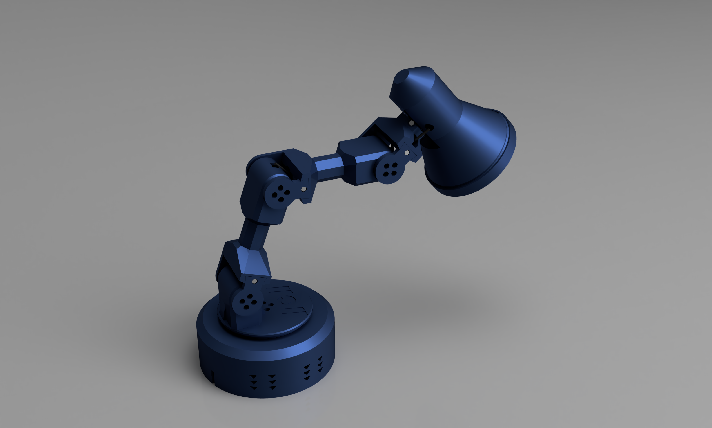
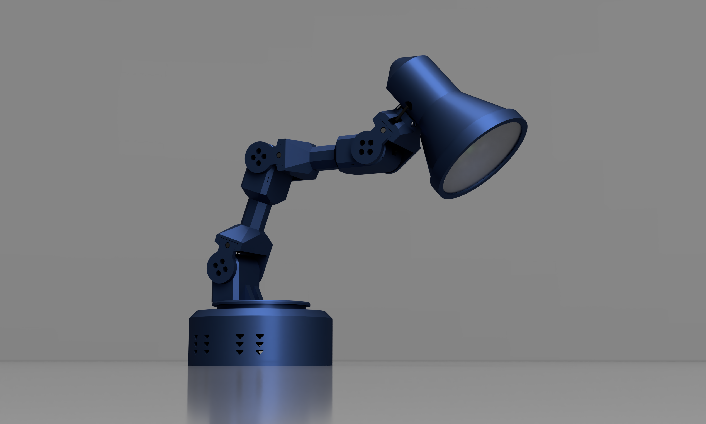
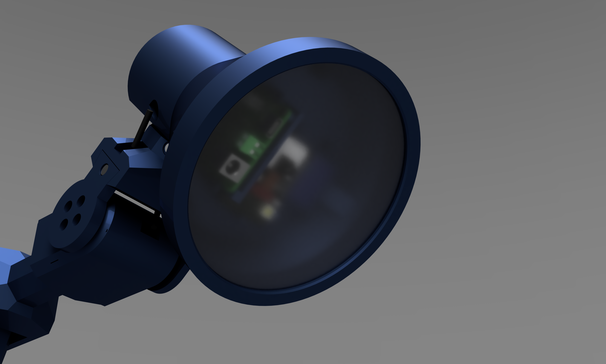
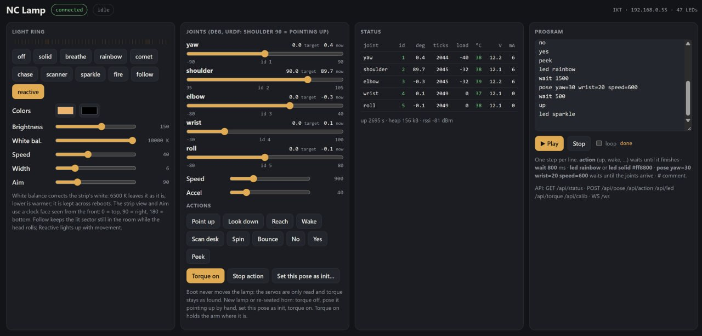
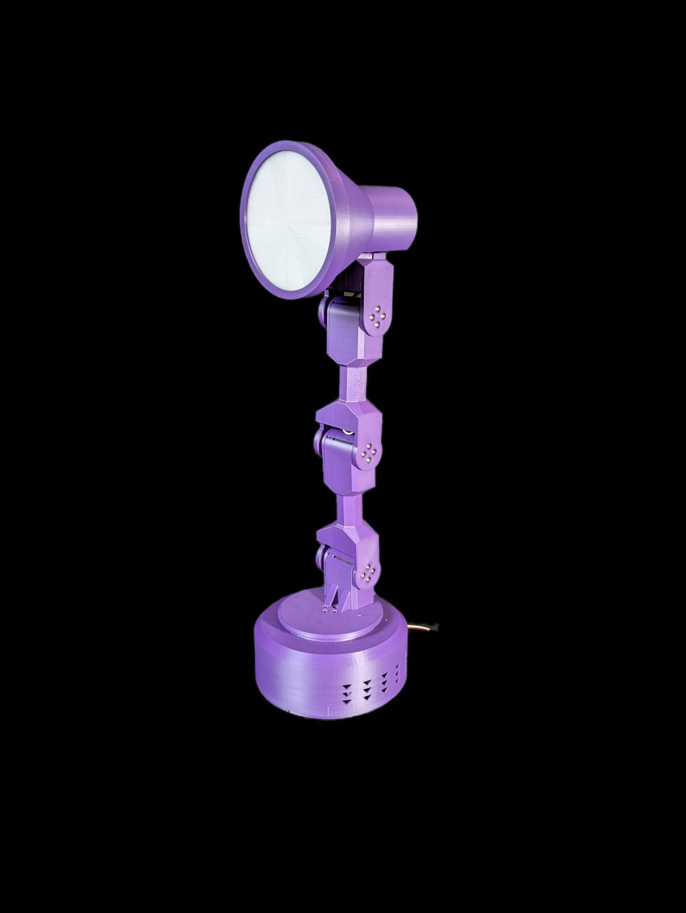

# Meet Lamp


<p>
  
</p>

A fully 3D-printed robotic desk lamp with 5 ST3215 bus servos: yaw in the base, shoulder, elbow, wrist and a head that rolls around its neck. 

## ✨ Why Lamp?

- 🖨️ **Fully 3D printed** - 17 parts in 12 shapes
- ⚙️ **5 DOF** on one serial bus - the same ST3215 servos as [ElRobot](../elrobot/)
- 💡 **Two ways to build it** - a simple version driven from your PC, or an LED version with an ESP32 in the head, a WS2812B light ring and a web UI
- 💰 **Affordable** - ~$140 (simple) / ~$160 (LED version)

## 🚀 Quick Start

1. **[🖨️ Print](#️-3d-printing)** - Download the .3mf files and print the parts
2. **[🛒 Buy](#️-bill-of-materials-bom)** - 5 servos, an adapter, a power source, ballast bolts
3. **[🔧 Assemble](#-assembly)** - Set the motor IDs, build from the base up
4. **[🔌 Wire](#-electronics--wiring)** - Power and bus, plus the head electronics for the LED version
5. **[🎯 Init](#-first-start-and-init-pose)** - Put the arm straight, store the init pose, torque on
6. **[🎉 Enjoy](#-community)** - Join the community and show your build!

## 📋 Quick Specs

| | |
|---|---|
| **DOF** | 5 (yaw, shoulder, elbow, wrist, head roll) |
| **Links** | 130 mm upper arm and forearm, 110 mm shade |
| **Base** | Ø160 mm, ballast bolts inside |
| **Servos** | 5× ST3215 12 V on one bus, IDs 1 (base) to 5 (head) |
| **Weight** | ~1.2 kg lamp + ~0.6 kg ballast |
| **Estimated cost** | ~$135 simple / ~$155 LED version |

## 🔀 Two Versions

| | Simple version | LED version |
|---|---|---|
| Electronics | Waveshare Bus Servo Adapter **in the base**, USB cable to your computer | ESP32-CAM + Waveshare Bus Servo Adapter **in the head** |
| Light | none | WS2812B ring in the shade (~48 LEDs) |
| Control | from the PC over USB: any ST3215 / Feetech bus library, the NormaCore station, or the Python tools in [`firmware/tools`](firmware/tools) | browser page over WiFi (sliders, actions, light effects, program editor), REST API, WebSocket |
| Head plate to print | none | `plate_espcam_ws_x1.stl` |
| Window disc | `window_disc_x1_PETG.stl` | `window_disc_x1_PETG.stl` (or the `_cam` disc if you want the lens exposed) |

Both versions share the same printed parts, servos and ballast. Only the electronics and the wiring differ.

> **No end stops.** The first motor (yaw, ID 1) and the last one (head roll, ID 5) have no mechanical end stops. Their travel is limited only by the servo cable loops and by the software limits. Do not force them past ±90° by hand, and keep the limits in the firmware config.

# 🛠️ Bill of Materials (BOM)

### Common parts (both versions)

| Part | Qty | Unit Cost | Links / Notes |
| :--- | :---: | :---: | :--- |
| **ST3215 Servo (12V/30kg)** | **5** | ~$22.00 | With horn, cable and screw bag. [SeeedStudio](https://www.seeedstudio.com/STS3215-30KG-Serial-Servo-p-6340.html) / AliExpress 6-pack: [Opt 1](https://aliexpress.com/item/1005009270126951.html) / [Opt 2](https://aliexpress.com/item/1005009339011602.html) |
| **Bus Servo Adapter (A)** | **1** | ~$5.00 | [Waveshare](https://www.waveshare.com/bus-servo-adapter-a.htm). Sits in the base (simple) or in the head (LED version) |
| **Power source, 12 V** | **1** | ~$8.00 | **Either** a 12 V / 5 A DC PSU (5.5×2.1 mm jack) **or** a USB Type-C PD trigger board set to 12 V with a PD charger of 60 W or more. See [Power](#power) |
| **Ballast: M16×70 hex bolts + M16 nuts** | 3 + 6 | ~$5.00 | Full-thread (DIN 933). Lie in three cradles on the bottom plate. ~585 g total. Other sets (M16×60, M14×80 ...) work too, aim for 500–600 g of steel |
| **USB-C data cable** | 1 | ~$5.00 | PC to the adapter (simple version) or first flash of the ESP32-CAM |

Screws come from the servo bags: 44× M3×6 and 20× M2 self-tapping.

### LED version only

| Part | Qty | Unit Cost | Links / Notes |
| :--- | :---: | :---: | :--- |
| **AI-Thinker ESP32-CAM** | **1** | ~$8.00 | Plus 4 Dupont jumpers (female ends on its pins). A CP2102 USB-serial adapter for the first flash if you don't have one |
| **WS2812B strip, 144 LED/m** | 333 mm | ~$5.00 | About 47 pixels, LEDs facing inwards in the mouth ring channel. 12 mm wide strip (10 mm works too) |
| **MP1584EN mini buck, 12 V → 5 V, 3 A** | **1** | ~$2.00 | Powers the strip and the ESP32-CAM. Set it to 5.0 V **before** connecting anything |
| **330 Ω resistor** | 1 | - | Optional, but better to have: In series with the strip data line |


### 📝 Hardware & Design Notes

* **Servo IDs:** every ST3215 ships with ID 1. Give them IDs **1 to 5, base to head**, one servo at a time, before assembling (see [Assembly](#-assembly)).
* **The firmware does not use the camera.** The ESP32-CAM is used because it is cheap and has enough free pins. Print the plain window disc unless you plan your own camera streaming.
* **Current budget:** 5 servos idle take ~1 A at 12 V, a hard stall is 2.7 A each. 48 LEDs at full white take up to 2.9 A at 5 V.

---

# 🖨️ 3D Printing

- **Filament needed:** ~550 g PLA + 7 g transparent PETG for the window disc (~19 h total at 0.2 mm)
- **Settings:** 0.4 mm nozzle, 0.2 mm layers, 2 walls, 15 % infill, **use supports for critical regions only**

<p>
  
  
</p>

## For Bambulab / Orca Slicer Users

| Profile | Link | Note |
|---|---|---|
| Bambu A1, PLA parts | [.3mf](print/lamp-a1-pla.3mf) | Ready to print project |
| Bambu A1, PETG discs | [.3mf](print/lamp-a1-petg.3mf) | Both window discs, pick one |

**Before printing:**
- **Head plate:** print `plate_espcam_ws_x1` for the LED version. The simple version needs no plate. The XIAO and ESP32-CAM + Seeed plates are included for experiments.
- **Window disc:** print `window_disc_x1_PETG` in transparent PETG, 100 % infill, slow. Or buy a 110 mm 0.8mm height acrylic/PET disc.

## For Other Printers

STL files are in [`/STL`](./STL). They are exported in assembly orientation, so lay each part on the face listed below.

| File | Qty | Lay on | Note |
|---|---|---|---|
| `base_cup_x1.stl` | 1 | roof (upside down) | tallest base part |
| `base_bottom_x1.stl` | 1 | flat, cradles up | ballast cradles and screw counterbores |
| `turntable_tower_x1.stl` | 1 | disc down, pod up | |
| `pod_lid_x3.stl` | 3 | rim down | |
| `rear_plate_x3.stl` | 3 | outer face (4 holes) down | |
| `link_x2.stl` | 2 | skin down | hub disc, knuckle and pod skin all on the bed |
| `neck_x1.stl` | 1 | skin down | |
| `head_cap_x1.stl` | 1 | pad down, flange up | |
| `shade_x1.stl` | 1 | mouth down, cap up | 146 mm tall |
| `bezel_x1.stl` | 1 | lip down, skirt up | |
| `window_disc_x1_PETG.stl` | 1 | flat | transparent PETG, 0.6 mm, 100 % infill |
| `plate_espcam_ws_x1.stl` | 1 | back face down, wall up | LED version only |

---

## 🔧 Assembly

**You'll need:**
- PH1, PH2 screwdrivers
- Small flat screwdriver (buck trimmer), side cutters, soldering iron (LED version)
- Optional: heat gun
- All BOM components listed above

### 1. Set the motor IDs

Every servo ships with ID 1. Change it using PC. Mark each servo with its ID. **ID 1 goes in the base (yaw), 2 shoulder, 3 elbow, 4 wrist, 5 head roll.**

### 2. Build from the base up

Every joint is the same pattern: the servo drops into its pod from the lid side (tricky part: put wire inside it place), horn first, and is fixed with 2× M2 through the skin. The next link's hub disc goes on the horn with 4× M3×6. On the other side a rear plate sits on the servo's free rear disc with 4× M3×6, its dovetail tongue slides into the knuckle and one M3×6 locks it.

1. **Base:** servo 1 hangs under the roof of the base cup (4× M2 from above). Lay the ballast bolts in the three cradles of the bottom plate, one nut clamps each bolt against its block, the rest of the nuts go on the free shank. Close the base with 6× M2 from below. 
2. **Turntable:** the turntable tower goes on the horn of servo 1 (4× M3×6). Servo 2 drops into its pod.
3. **Upper arm and forearm:** both are the same `link` part. Hub on the horn of the servo below, pod for the servo above, pod lid hooked at the rear, rear plate on the free disc.
4. Assemble Head and Neck before assembling forearm.
5. **Neck:** hub on the wrist servo (4), head cap on servo 5 (4× M3×6), the neck boss over the cap flange (4× M3×8 on the diagonals).
6. **Head:** servo 5 sits in the shade (4× M2 from outside). LED version: LED strip into the channel inside the mouth ring, electronics plate bayonets into the three lugs (insert, turn 25°, click) and 3× M2 through the rim. Window disc on the mouth ring, screw the bezel on (1.5 turns).

Run each servo cable through the link bores as you go. The cable from servo 1 to 2 has a 100 mm loop under the turntable, the cable from 4 to 5 loops outside the neck. These two loops are what limits yaw and head roll, since those joints have no end stops.

---

## 🔌 Electronics & Wiring

### Power

The servos run from **12 V**. Pick one:

- **DC power supply**, 12 V / 3 A, 5.5×2.1 mm barrel jack, or
- **USB Type-C PD trigger** board. Set its voltage to **match the motor voltage (12 V)** and use a PD charger of 36 W or more. Handy if you already have USB-C chargers around.

The power cable enters through the keyhole slot at the rear of the base cup.

**Simple version:** the adapter sits in the base, so the power goes into the adapter's DC jack or screw terminal, and the adapter's bus connector goes to servo 1.

**LED version:** there is no board in the base. **Take a spare servo wire** (a 3-pin ST3215 cable: the spare from a 6-pack, or any servo extension cable), cut off one plug, connect its **12 V and GND** leads to your power source and plug the other end into the **spare socket of servo 1**. The data pin stays unconnected. The bus then runs up through the arm, and the last servo (5) feeds the adapter in the head.

### Simple version wiring

```
12 V PSU / PD trigger --> Bus Servo Adapter (A) power in       (adapter in the base)
PC USB-C ------------> adapter USB
adapter 3-pin bus ---> S1 -> S2 -> S3 -> S4 -> S5                 (each servo passes the bus on through its second socket)
```

Fix the adapter inside the base cup with hot glue, and route the USB cable out through the second (spare) keyhole slot. Drive the lamp from the PC with any ST3215 / Feetech bus library.

### LED version wiring

```
12 V PSU / PD trigger --spare servo wire--> S1 spare socket (12 V, GND)
S1 -> S2 -> S3 -> S4 -> S5 ---------------> Bus Servo Adapter (A) 3-pin bus socket      (adapter in the head, on the plate)

Adapter UART header (labelled from the host side, NOT crossed):
  ESP32-CAM GPIO14 (TX) -> adapter TXD
  ESP32-CAM GPIO15 (RX) -> adapter RXD
  ESP32-CAM GND         -> adapter GND
  Adapter jumper block: both caps on "A"

Adapter screw terminal (12 V, GND) -> MP1584 IN, MP1584 OUT set to 5.0 V
  MP1584 OUT 5 V -> ESP32-CAM 5V pin  and  strip 5V
  GND common

ESP32-CAM GPIO13 -> 330 Ω -> strip DIN
```

Notes:
- Set the buck to 5.0 V with a multimeter **before** connecting the ESP32-CAM or the strip.
- The adapter does not echo and is fine with 3.3 V logic. If the servos don't answer, open `http://<lamp-ip>/api/diag`: it tries normal and swapped RX/TX at three baud rates and tells you which one works.
- 3.3 V data into a 5 V WS2812B strip works on most strips. If the ring glitches, add a 74AHCT1G125 level shifter on the data line.
- The ESP32-CAM pins used are 13, 14 and 15. UART0 (pins 1 and 3) stays free for the programmer.

---

## 💾 Firmware (LED version)

PlatformIO project in [`firmware/espcam`](firmware/espcam). Install [PlatformIO](https://platformio.org/) (VS Code extension or `pip install platformio`).

### 1. Set your WiFi

Open [`firmware/espcam/include/config.h`](firmware/espcam/include/config.h) and replace the placeholders:

```c
#define WIFI_STA_SSID        "YOUR_WIFI_SSID"
#define WIFI_STA_PASS        "YOUR_WIFI_PASSWORD"
```

If the network is not reachable within 15 s the lamp opens its own access point `nc-lamp` (password `nclamp123`), so you can always reach it.

In the same file check `LED_COUNT` (count the pixels on your strip), and after the first start `LED_START_DEG` / `LED_DIR` (where the strip's first LED sits and which way it runs, seen from the front).

### 2. Flash

First flash over a USB-serial adapter (connect IO0 to GND, press RST, then release IO0 after the upload starts):

```
cd firmware/espcam
pio run -e espcam -t upload --upload-port <your serial port>
pio device monitor -p <your serial port>
```

Later updates go over WiFi:

```
pio run -e ota -t upload --upload-port <lamp ip>
```

### 3. Open the page

Get the lamp's IP from your router (or from the serial monitor), and open it in a browser. `http://lamp.local` also works on networks with mDNS.



The page has the light ring effects, joint sliders, canned actions (wake, scan, nod, shake ...), a small program editor and the API reference:

| Call | Body | Effect |
|---|---|---|
| `GET /api/status` | | joints (deg, ticks, load, temp, V, mA), torque, action, led, wifi |
| `POST /api/pose` | `{"yaw":0,"shoulder":90,"elbow":0,"wrist":0,"roll":0,"speed":900,"acc":40}` | move; refused if the shade would hit the desk |
| `POST /api/action` | `{"name":"wake"}` | up, lookdown, reach, wake, scan, spin, bounce, no, yes, peek; `""` stops |
| `POST /api/led` | `{"mode":"breathe","color":"#ffb15c","bri":150,"spd":40}` | light ring |
| `POST /api/torque` | `{"on":true}` | torque on holds the current pose |
| `POST /api/calib` | `{"joints":[]}` | store the current pose as init |
| `WS /ws` | same JSON objects as the page | status pushed 10 times a second |

---

## 🎯 First Start and Init Pose

Boot never moves the lamp: the firmware only reads the servos and leaves torque as it finds it (off after a power-up). A freshly built lamp has its horns seated at random angles, so tell it once where "straight" is:

1. **Torque off** (it already is after power-up).
2. **Put the arm straight:** arm vertical, every link in line, head looking straight along the arm. **Match the back of the arm with the back of the base** (the base's rear is the side with the cable slot). Like this:

   

3. On the web page click **Set this pose as init…** and confirm with **Write offsets**. This writes the position correction into every servo's EEPROM, so this pose reads 2048 ticks on all five joints. It survives power off.
4. Click **Torque on**. The lamp holds its pose and is ready for action: try the sliders with small moves first and check every joint runs the right way, then the actions.

**Simple version:** do the same with the Python tool, with the arm held in the pose above:

```
python firmware/tools/center_servo.py 1 2 3 4 5
```

Redo this whenever you re-seat a horn.

---

## 🎮 Simulation

[`/simulation`](./simulation) holds the URDF with meshes and a standalone browser viewer (`viewer.html`, three.js from a CDN). Serve the folder with any static server and open the page:

```
cd simulation && python -m http.server 8000
```

Joint names and angle conventions match the firmware: shoulder 90° = pointing up, the init pose is all joints at their centre.

## 📁 Source Files

| Type | Link |
|------|------|
| STL | [/STL](./STL) |
| STEP | [/STEP](./STEP) - every part plus `_lamp_assembly.step` |
| Print files (.3mf) | [/print](./print) |
| Firmware | [/firmware](./firmware) |
| URDF | [/simulation](./simulation) |

## 🌐 Community

**Website:** [normacore.dev](https://normacore.dev)

**Follow us:**
- 🐦 [X/Twitter](https://x.com/norma_core_dev)
- 🎥 [YouTube](https://www.youtube.com/@normacoredev)
- 💼 [LinkedIn](https://www.linkedin.com/company/normacore/)
- 📢 [Reddit](https://www.reddit.com/r/NormaCore/)

**Join & Contribute:**
- 💬 [Discord](https://discord.gg/Z4Ytw3QfHP) - Chat with the community
- 🐙 [GitHub](https://github.com/norma-core/norma-core) - Source code & issues
