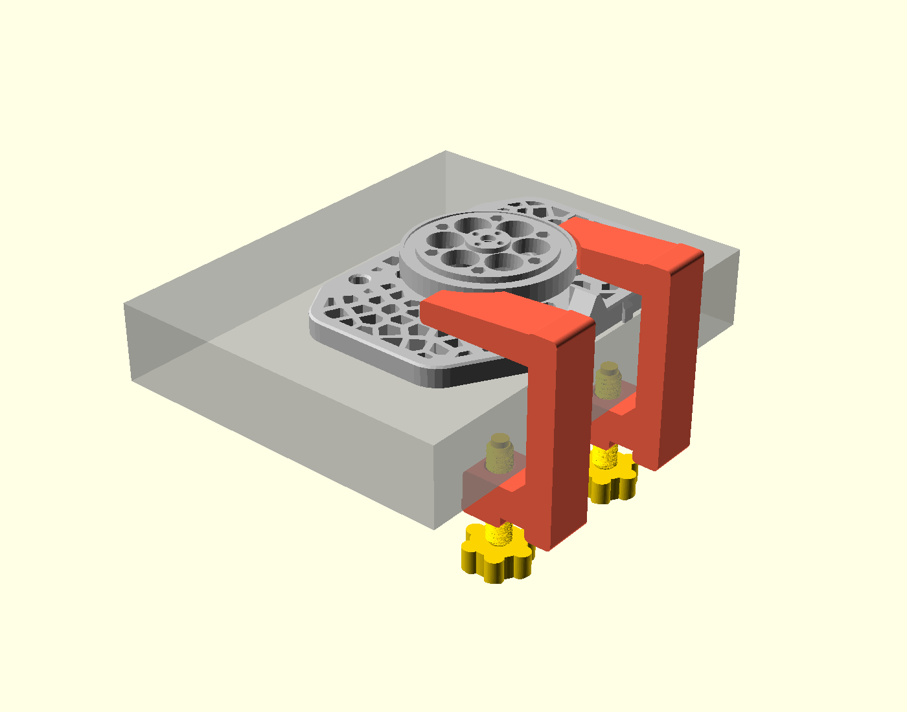

# SO-ARM102 table clamp

Fully printed clamps that hold an SO-ARM102 (leader or follower) on the edge of a
tabletop. No screws into the table, no metal hardware: the only parts are the
printed clamp body, a printed thumbscrew and an optional pressure pad.



## How it works

The SO-102 base is a 10 mm plate with four Ø8.2 mm mounting holes on an
80 × 80 mm grid. Each clamp is a C-clamp with a Ø7.6 mm peg on the upper jaw.
The peg drops into one of the base holes, the jaw presses the plate down onto
the table, and the thumbscrew in the lower jaw pushes up against the underside
of the table. Two clamps on the two holes nearest the table edge are enough.

The upper jaw reaches to the middle of the base (56 mm in from the table edge)
so the plate is held down over its whole rear half. At that length the jaw has
to clear the Ø78 mm motor boss, so it has a scallop on its inner side and the
two clamps are mirror images (`left` / `right`). The scallop faces the motor;
if a clamp does not sit flat, you have the two swapped.

Default geometry: the base sits with its **back edge (the side with the serial
adapter tabs) flush with the table edge**, on a **40 mm** thick tabletop. The
screw has about ±8 mm of range, so tables from ~32 mm to ~48 mm work without
changing anything.

## Print

| Part | Qty | Orientation | Notes |
|---|---|---|---|
| `STL/so102_clamp_body_left.stl` | 1 | lying on its flat side | 4+ walls, 30 %+ infill. The peg and the threaded hole are horizontal in this orientation; Bambu prints both fine without supports. |
| `STL/so102_clamp_body_right.stl` | 1 | lying on its flat side | Mirror of the left one. |
| `STL/so102_clamp_screw.stl` | 2 | knob down, thread up | 4+ walls so the thread is solid. 0.2 mm layers or finer. |
| `STL/so102_clamp_pad.stl` | 2 | socket up | Optional. Snaps onto the screw tip and spreads the load on the table underside. |

PETG is the better choice (it creeps less under constant clamping load than
PLA); PLA works if that is what you have. Do not print the body standing up:
the jaws would then be stacked layers at the root and snap.

If the printed thread is tight, run the screw in and out a few times, or raise
`thr_clear` in the `.scad` by 0.1 mm and re-export the body.

## Install

1. Put the base on the table with the serial-adapter edge flush with the table edge.
2. Hook a clamp over the edge at each of the two back holes so the peg drops
   into the hole. The clamp spine hangs just outside the table edge.
3. Push the pad onto the screw tip, thread the screw in from below and tighten
   by hand until the base cannot be rocked.

## Other table thicknesses or edges

Everything is parametric in `so102_table_clamp.scad`:

- `table_t` — tabletop thickness (default 40).
- `hole_from_edge` — distance from the hole centre to the base edge that sits
  at the table edge: `22.5` for the back edge (default), `10` for the front
  edge, `40` for either long side. If you change the edge, also set `boss_x`
  (motor boss centre from that edge) and `hole_y` so the scallop lands right.
- `jaw_reach` — how far the upper jaw reaches in from the table edge
  (default half the base, 56 mm).
- `side` — `1` or `-1`, which side the scallop is on (left / right body).
- `W`, `spine_t`, `jaw_root`, `lower_t` — beef up the clamp if you need more
  clamping force.

Re-export with:

```bash
openscad -D 'part="body"' -D side=1  -o STL/so102_clamp_body_left.stl  so102_table_clamp.scad
openscad -D 'part="body"' -D side=-1 -o STL/so102_clamp_body_right.stl so102_table_clamp.scad
openscad -D 'part="screw"'           -o STL/so102_clamp_screw.stl      so102_table_clamp.scad
openscad -D 'part="pad"'             -o STL/so102_clamp_pad.stl        so102_table_clamp.scad
```

`part="assembly"` shows the clamp on a ghost table with the base plate corner
for checking fit in the OpenSCAD preview.

Note: the lower jaw reaches 32 mm under the table. If your desk has an apron or
frame rail right under the edge, that will be in the way.
